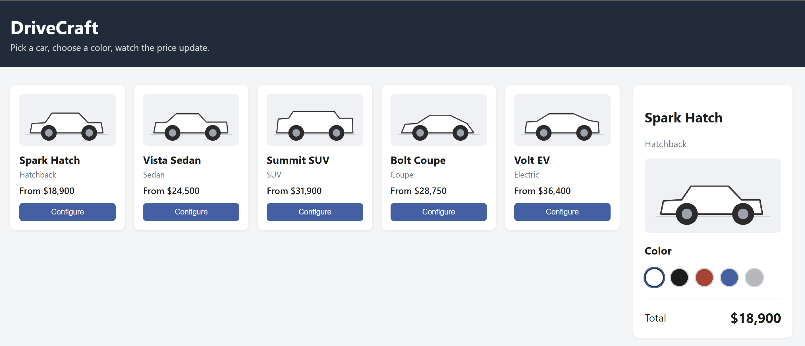

# DriveCraft – Car Configurator

**Pick a car, choose a color and wheels, watch the price update.**

DriveCraft is a simple, interactive car configurator that lets users explore 5 different vehicle models, select their preferred paint colour and wheel type, and instantly see the final price update in real time.

---

## Overview

| Field | Details |
| --- | --- |
| **Application Name** | DriveCraft |
| **Type** | Web-based Car Configurator |
| **Vehicles Available** | 5 |
| **Configurable Options** | Vehicle model, Paint colour, Wheel type |
| **Pricing** | Base price + colour surcharge + wheel surcharge |

---

## Application Screenshot



---

## Vehicle Configurations

The following 5 vehicle models are available for configuration. Each model has a base price which serves as the starting total before any colour or wheel surcharge is applied.

| # | Model | Type | Base Price |
| --- | --- | --- | --- |
| 1 | **Spark Hatch** | Hatchback | $18,900 |
| 2 | **Vista Sedan** | Sedan | $24,500 |
| 3 | **Summit SUV** | SUV | $31,900 |
| 4 | **Bolt Coupe** | Coupe | $28,750 |
| 5 | **Volt EV** | Electric | $36,400 |

---

## Colour Options & Pricing

Each vehicle can be configured with one of 5 available paint colours. A colour surcharge is added on top of the selected vehicle's base price.

| Colour | Additional Cost | Notes |
| --- | --- | --- |
| ⬜ White | $0 | No additional cost — included in base price |
| ⬛ Black | +$300 |  |
| 🟥 Red | +$250 |  |
| 🟦 Blue | +$250 |  |
| 🩶 Silver | +$500 | Premium finish |

---

## Wheel Options & Pricing

Each vehicle can be configured with a wheel type. There is one **base wheel** available for all vehicles, plus **exclusive wheel options** unlocked for specific models only. Wheel options are displayed in the configuration panel when a vehicle is selected.

### Base Wheel (All Vehicles)

| Wheel | Additional Cost | Availability |
| --- | --- | --- |
| 🔘 **Standard Alloy** | $0 | All 5 vehicles — included in base price |

### Exclusive Wheels (Vehicle-Specific)

The following wheel options are only available for specific vehicle models. They are shown in the UI only when the matching vehicle is selected, giving each configuration a unique set of personalisation choices.

| Vehicle | Exclusive Wheel | Additional Cost | Design Rationale |
| --- | --- | --- | --- |
| **Summit SUV** | 🛞 Off-Road Rugged Tyres | +$1,200 | Heavy-duty tread pattern suited to the SUV's off-road capability and robust character |
| **Bolt Coupe** | 🏎️ Sport Low-Profile | +$800 | Sleek, wide low-profile wheels that complement the Coupe's performance-oriented styling |
| **Volt EV** | ⚡ Aero Efficiency Wheels | +$600 | Aerodynamically optimised enclosed-spoke design to reduce drag and maximise EV battery range |

**UI Behaviour:** Exclusive wheel options are only visible when the matching vehicle is selected. Selecting a different vehicle resets the wheel choice to *Standard Alloy* if the previously chosen wheel is not available for the new model.

---

## Wheel Visual Design Specifications

Each wheel type has a dedicated icon displayed in the configuration panel when the user selects a vehicle. All icons follow the same **minimal line-art style** used throughout the DriveCraft UI — dark charcoal strokes on light grey fills, no gradients, flat and clean.

### Design Style Guide

| Property | Value |
| --- | --- |
| Icon size | 60 × 60 px (rendered at 2× for retina: 120 × 120 px) |
| Stroke colour | `#2d3748` (dark charcoal — matches vehicle illustrations) |
| Tyre fill | `#d8d8d8` (medium grey) |
| Rim fill | `#ebebeb` (light grey) |
| Style | Outline / stroke-based, flat fills, no gradients, no shadows |
| Format | SVG (scalable) — exported to PNG for rendering in UI |
| Selection state | Blue border ring `#4a6fa5` (matches colour swatch selection style) |

### Wheel Icon Designs

| Wheel | Icon | Visual Characteristics | Vehicles |
| --- | --- | --- | --- |
| **Standard Alloy** |  | 5 evenly-spaced spokes at 72° intervals; medium tyre wall thickness; classic alloy wheel proportions; small solid centre hub | All vehicles (base) |
| **Off-Road Rugged Tyres** |  | Extra-thick tyre ring (large outer-to-rim gap); 12 radial tread marks around tyre perimeter; 4 wide X-pattern spokes (45° offset); chunky, rugged proportions — small rim area | Summit SUV only |
| **Sport Low-Profile** |  | Very thin tyre wall (small outer-to-rim gap); 10 thin spokes at 36° intervals; large exposed rim area — wide, clean look; minimal centre hub | Bolt Coupe only |
| **Aero Efficiency Wheels** |  | 5 closed turbine-blade segments (pinwheel pattern); enclosed spoke design — no open gap between hub and rim; curved blade shapes suggest aerodynamic airflow; smooth continuous surface with minimal air gaps | Volt EV only |

---

## Price Calculation

```text
Total Price = Base Vehicle Price + Colour Surcharge + Wheel Surcharge
```

**Example 1:** Spark Hatch + Black + Standard Alloy = $18,900 + $300 + $0 = **$19,200**

**Example 2:** Summit SUV + White + Off-Road Rugged Tyres = $31,900 + $0 + $1,200 = **$33,100**

**Example 3:** Volt EV + Silver + Aero Efficiency Wheels = $36,400 + $500 + $600 = **$37,500**

**Example 4:** Bolt Coupe + Red + Sport Low-Profile = $28,750 + $250 + $800 = **$29,800**

---

## How It Works

1. **Select a vehicle** — Choose from one of the 5 available models displayed as cards.
2. **Pick a colour** — Select a paint colour from the colour swatches in the configuration panel on the right.
3. **Choose wheels** — Select a wheel type from the icon-based selector in the configuration panel. The Standard Alloy is always available; exclusive wheels appear only for compatible models.
4. **View total** — The total price updates instantly to reflect the base price plus any colour and wheel surcharges.
